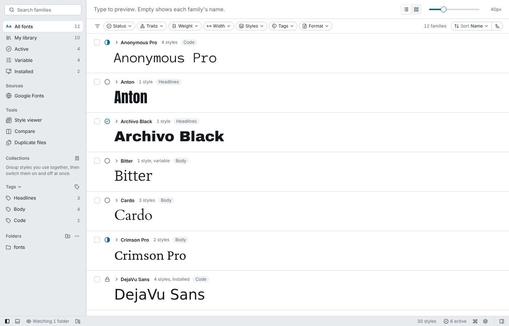
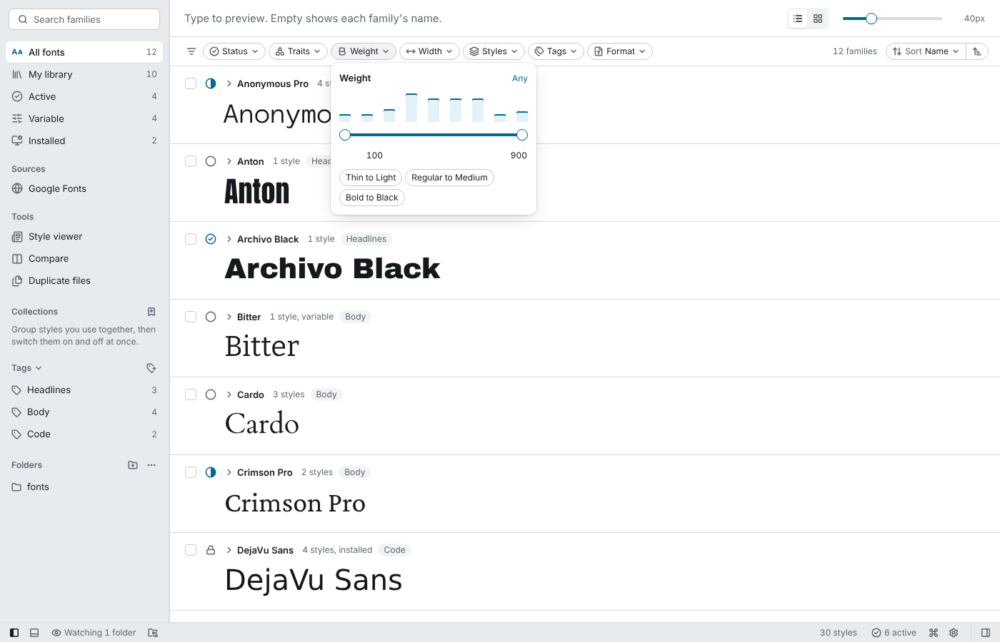
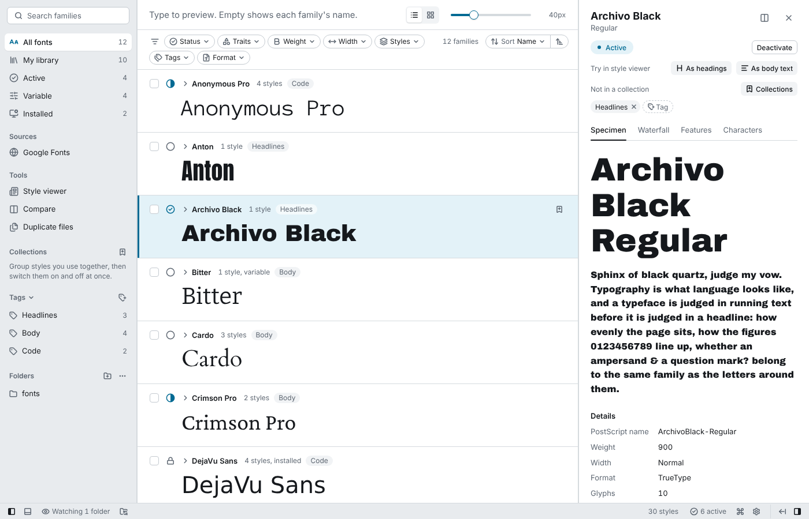
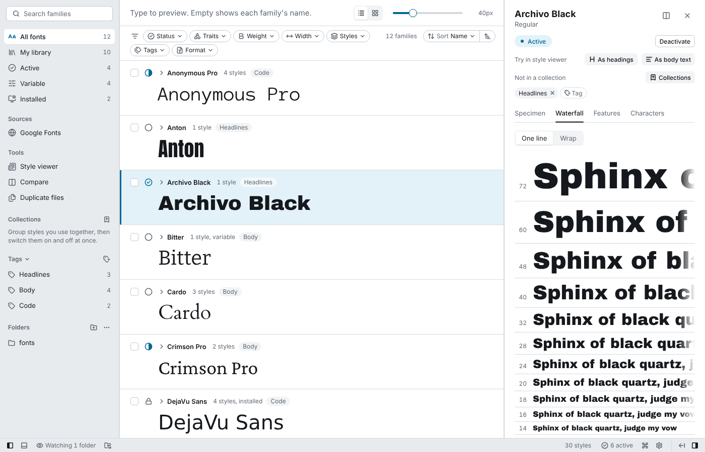
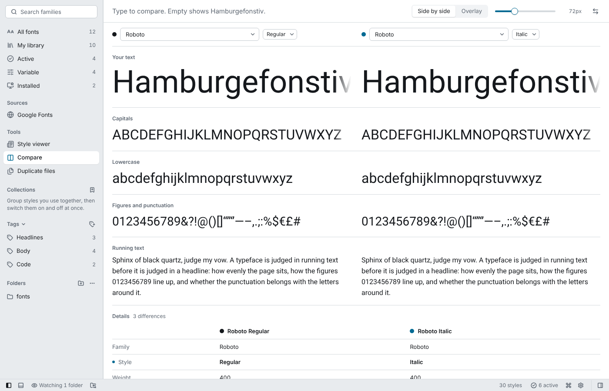
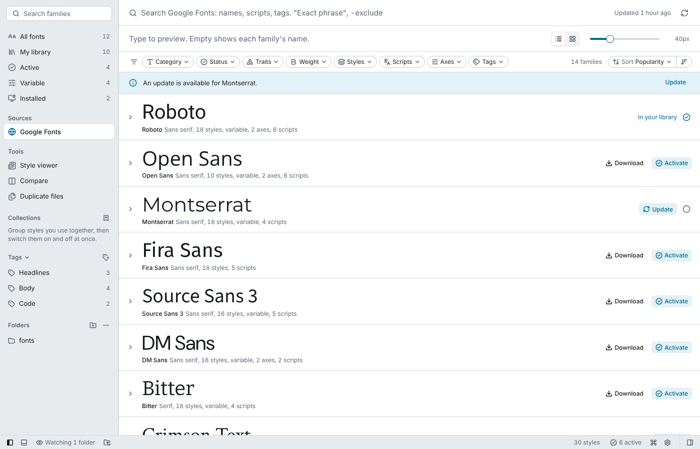
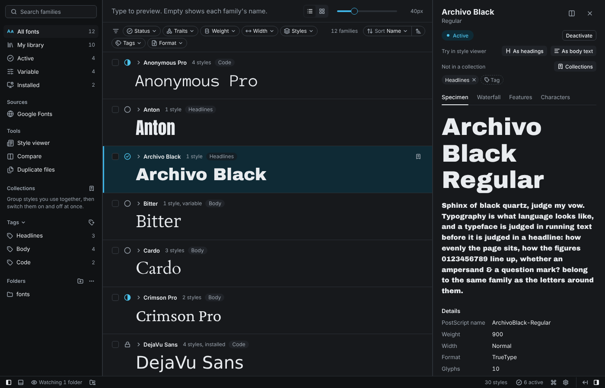
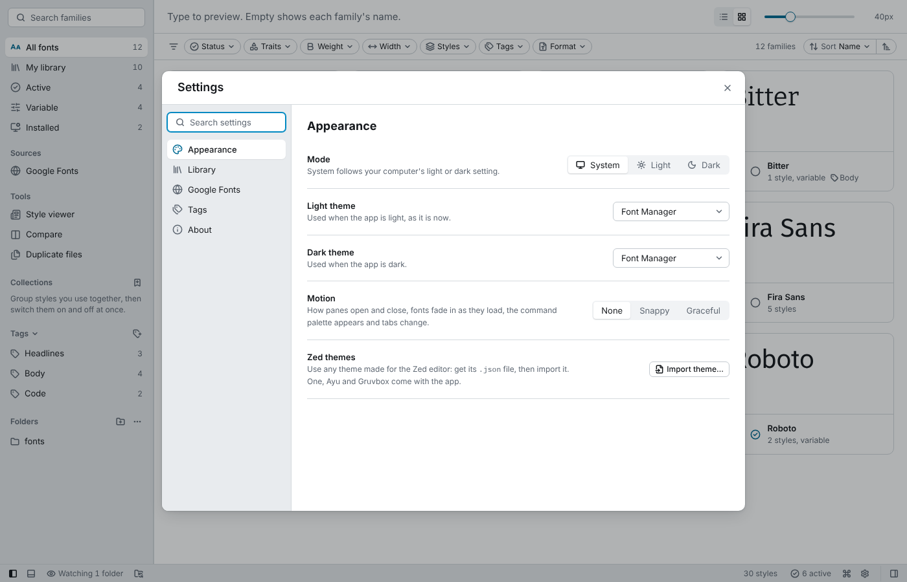

# Font Manager

Browse every font you own, preview any of them without installing it, and switch
individual styles on and off when you need them. It also searches Google Fonts,
so you can try a family and activate it in one step.

Font Manager runs on Windows, macOS and Linux, and it's free and open source.

## Install

Download the installer for your system from the
[latest release](https://github.com/koee-works/fontman/releases/latest).

| System | File | Notes |
| --- | --- | --- |
| Windows | `.msi` or `-setup.exe` | Windows may show a SmartScreen warning: choose **More info**, then **Run anyway**. |
| macOS | `.dmg` (Apple silicon) | Open the disk image and drag Font Manager to Applications. The first time, right-click it and choose **Open**. |
| Linux | `.AppImage`, `.deb` or `.rpm` | The AppImage runs as it is: mark it executable and open it. |

The installers aren't signed with a paid Windows or Apple certificate, which is why
those warnings appear. The app's own updates are signed, and it only installs
updates that match.

## Getting started

1. **Open the app.** It lists the fonts already installed on your computer. They
   show a lock: your system owns them, so they're always on.
2. **Add your fonts.** Use the folder-plus button beside **Folders** in the sidebar and
   pick a folder where you keep fonts. Font Manager reads it and keeps watching it, so fonts you add
   or remove later appear within a few seconds.
3. **Switch fonts on and off.** The circle beside a family or style turns it on or
   off. A half-filled circle means some styles are on. Other apps see the font
   straight away, with no restart and no copying files into a system folder.

Fonts in your folders stay where they are. Switching a font on registers it with
your system; switching it off removes it again.

## Find the right font

Searching, filtering and sorting are all in the bar above the list.

- **Search** by family name. Put a phrase in quotes to match it exactly, and a minus
  sign before a word to leave it out: `"fira sans"` or `sans -mono`. A typo like
  `montsrat` still finds Montserrat.
- **Filter** by status, traits, weight, width, number of styles, tags and file
  format. Each filter shows how many families match every choice before you pick
  it, so you never land on an empty list. Filters you've set show as chips you
  can remove one by one.
- **Sort** by name, number of styles, date modified, weight range, activation and more, and reverse the order
  with the button beside it. While you're searching, the best match comes first.

Your sample text and size apply to every row. Type your own words in the box at the
top to see how a design reads, or leave it empty to see each family's name in its
own typeface. Switch between a list and a grid with the buttons beside it.

## Look closely

Click a family to open the inspector on the right. It shows the specimen and
details, and has tabs for a waterfall of sizes, the OpenType features the font
supports, and every character it contains. Variable fonts get a slider for each axis.

Other tools sit under **Tools** in the sidebar:

- **Compare** puts two styles on the same text, side by side or as an overlay that
  shows where their shapes differ.
- **Style viewer** sets a heading font and a body font on a sample page, to check
  how they work as a pair.
- **Duplicate files** finds fonts saved more than once and moves the extra copies
  to the Trash or Recycle Bin. It never deletes outright.

## Organize

- **Collections** group styles you use together for a project, so you can switch
  them all on and off at once.
- **Tags** label families however you like, such as Headlines, Body or Client work.
  Filter by them in the bar above the list.
- **Drag and drop.** Drag a family onto a collection or tag in the sidebar.
- **Select several** with the checkboxes, then use the bar that appears at the
  bottom to activate, deactivate, collect or tag them together.

## Google Fonts

Choose **Google Fonts** in the sidebar to browse the whole catalog with the same
search, filters and sort as your library, plus category, scripts and variable axes.
Each family previews in its own typeface without downloading it.

- **Activate** downloads a family and turns it on in one step.
- **Download** saves it to your library without turning it on.
- Open a family's arrow for a closer look before you decide.
- Downloaded families can be switched on and off right there, and show **Update**
  when Google publishes a new version.

Google asks for a free API key. **Settings → Google Fonts** walks you through
getting one. The key is kept in your system's keychain where there is one, and
Font Manager talks to Google only to fetch the catalog and the font files.

## Make it yours

Open **Settings** with Ctrl+, (⌘+, on a Mac), or the gear in the status bar. You can
choose light, dark or follow your system, pick a theme, and turn motion off or down.
The command palette (Ctrl+Shift+P, or ⌘+Shift+P) runs any action by name.

Font Manager comes with the One, Ayu and Gruvbox themes, and you can import any
theme made for the [Zed](https://zed.dev) editor.

## Updates

Font Manager checks for a new version when it starts and shows **Update to x.y.z**
in the status bar. Settings → About has **Update and restart**, which downloads and
installs it. Nothing installs until you choose it, and you can turn the check off.
On Linux, `.deb` and `.rpm` installs can't replace themselves, so get those from the
releases page.

Updating keeps everything: your folders, collections, tags, which fonts are on, your
Google key, your theme and your settings. You can also install a newer version over
the old one. Before a new version first opens your library, it makes a backup, and
the last five are kept. **Settings → About → Show backups** opens them.

## Questions

**Where is my data?** In your user data folder, not next to the app. Uninstalling
leaves it in place unless you choose to remove app data.

**Does it change my font files?** No. It reads them and records what it finds in its
own index.

**Why can't I switch off some fonts?** The ones with a lock are installed by your
operating system. Only fonts in folders you added can be switched off.

**Something is wrong.** Please [open an issue](https://github.com/koee-works/fontman/issues)
and say which system you're on and the version shown in Settings → About.

## For developers

Building from source, how each part works, and how it's tested are in
[docs/DEVELOPMENT.md](docs/DEVELOPMENT.md). The visual design is in
[DESIGN.md](DESIGN.md). The app is built with Rust, Tauri 2 and Svelte 5.

## License

MIT. Icons are from [Lucide](https://lucide.dev); see [licenses](licenses).
